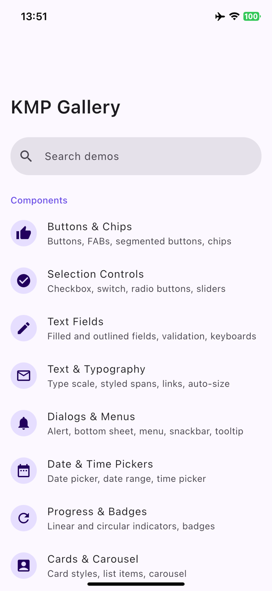
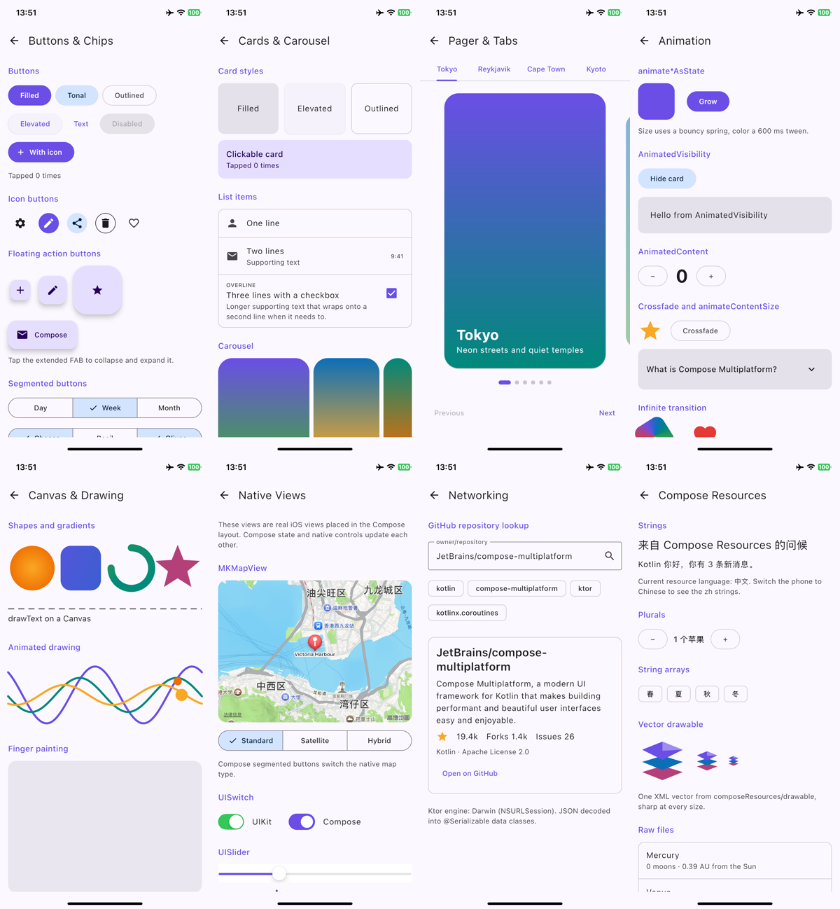

<div align="center">

# Kotlin Multiplatform Gallery

**English** · [简体中文](README_zh.md)

21 Compose Multiplatform demos in one iOS app: Material 3 components, lazy lists and grids, pager, app bars, animation, Canvas, gestures, Compose Resources, `expect` / `actual` platform APIs, MapKit and UIKit views inside Compose, Ktor networking, coroutines and Flow, and persistent storage.<br/>
The whole UI is shared Kotlin code; the iOS app is a small SwiftUI shell around it.<br/>
Builds and runs on iPhone from Windows, Linux or macOS with [KXBuild](https://github.com/kxbuild/kxbuild).



</div>

## What's inside

| Section | Demo | Shows |
|---|---|---|
| **Components** | Buttons & Chips | Filled / tonal / outlined / elevated / text buttons, icon buttons, FABs, single and multi-choice segmented buttons, assist / filter / input / suggestion chips |
| | Selection Controls | `TriStateCheckbox` with children, `Switch` with a thumb icon, radio group, `Slider` (continuous and stepped), `RangeSlider` |
| | Text Fields | Filled and outlined fields, email validation, password visibility, phone and decimal keyboards, prefix / suffix, character counter |
| | Text & Typography | Material type scale, font styles, gradient text, `AnnotatedString` with links, `SelectionContainer`, ellipsis, `TextAutoSize` |
| | Dialogs & Menus | `AlertDialog`, `ModalBottomSheet`, `DropdownMenu`, snackbar with an action, tooltip |
| | Date & Time Pickers | `DatePickerDialog`, `DateRangePicker`, `TimePicker` with a keyboard mode, inline `DatePicker` |
| | Progress & Badges | Linear and circular indicators (indeterminate and animated), `BadgedBox` |
| | Cards & Carousel | Filled / elevated / outlined cards, `ListItem` variants, `HorizontalMultiBrowseCarousel` |
| **Layout & Navigation** | Lazy Lists | Sticky headers, swipe to delete, `animateItem`, `PullToRefreshBox` |
| | Grids & Flow Layouts | `LazyVerticalGrid` with full-width headers, `LazyVerticalStaggeredGrid`, `FlowRow` |
| | Pager & Tabs | `HorizontalPager` with scaling pages, tabs synced with the pager, page indicator |
| | App Bars & Navigation | Collapsing `MediumTopAppBar`, `NavigationBar` with badges, `ModalNavigationDrawer`, shrinking extended FAB |
| **Graphics & Motion** | Animation | `animate*AsState` with springs, `AnimatedVisibility`, `AnimatedContent`, `Crossfade`, `animateContentSize`, infinite transitions, `Animatable` |
| | Canvas & Drawing | Shapes, paths, linear / radial / sweep gradients, dashed lines, `drawText`, animated waves, finger painting |
| | Gestures | Tap / double tap / long press, drag, pinch-zoom + rotate + pan with `transformable` |
| **Kotlin Multiplatform** | Compose Resources | Localized strings (English and Chinese), plurals, string arrays, an XML vector, a JSON file read with `Res.readBytes` |
| | Platform APIs | `expect` / `actual` functions backed by `UIDevice`, `NSProcessInfo`, haptic feedback generators, `UIActivityViewController`, `openURL` |
| | Native Views | `MKMapView`, `UISwitch`, `UISlider` and `UIDatePicker` embedded with `UIKitView`, kept in sync with Compose state |
| | Networking | Ktor client on the Darwin engine, kotlinx.serialization, GitHub repository lookup |
| | Coroutines & Flow | Cancellable ticker, parallel `async` / `awaitAll`, debounced search with `snapshotFlow`, CPU work on `Dispatchers.Default` |
| | Key-Value Storage | Settings and a JSON to-do list saved in `NSUserDefaults` through an `expect object` |

The home screen has search, navigation uses Navigation 3, and the app follows the system light / dark mode.



Built with Kotlin 2.4.21, Compose Multiplatform 1.12.1, Material 3, Navigation 3 and Ktor 3.6. Targets iOS 16 and later.

## Run it on an iPhone

You need KXBuild installed ([install guide](https://github.com/kxbuild/kxbuild#-install)), [signing](https://github.com/kxbuild/kxbuild#-signing) set up, and JDK 17 or later (or Android Studio, which bundles one).

```shell
git clone https://github.com/kxbuild/kotlin-multiplatform-gallery.git
cd kotlin-multiplatform-gallery

# Once per machine and after changing the Kotlin version: prepares Kotlin/Native for iOS
kxbuild doctor iosApp/KmpGallery.xcodeproj

# Build, install on the USB-connected iPhone and launch it
kxbuild run iosApp/KmpGallery.xcodeproj
```

The first build downloads Gradle and the Kotlin libraries and links the Kotlin framework, so it takes several minutes. The build runs `./gradlew :composeApp:embedAndSignAppleFrameworkForXcode` by itself; you never call Gradle directly.

The bundle identifier is `com.kxbuild.kmpgallery`. If your provisioning profile does not cover it, switch to one of yours:

```shell
kxbuild project add-setting --project iosApp/KmpGallery.xcodeproj --target KmpGallery --key PRODUCT_BUNDLE_IDENTIFIER --value com.yourcompany.kmpgallery
```

To open one demo right away, pass its id as a launch argument, for example `--args "-demo native"`. The ids are listed in [Demo.kt](composeApp/src/commonMain/kotlin/com/kxbuild/kmpgallery/Demo.kt).

For an App Store build, use the Release configuration; the `.ipa` is written to `iosApp/build`:

```shell
kxbuild build iosApp/KmpGallery.xcodeproj -c Release
```

### In VS Code

Install the KXBuild extension, open this folder, pick the iPhone in the KXBuild view and press F5 to build, install and debug.

## Project layout

```
composeApp/src/
  commonMain/kotlin/…/kmpgallery/
    App.kt                  theme, navigation and the home screen
    Demo.kt                 the list of demos and their ids
    Platform.kt             expect declarations for platform APIs
    demos/Components.kt     buttons, selection, text, dialogs, pickers, progress, cards
    demos/Layout.kt         lists, grids, pager, app bars
    demos/Graphics.kt       animation, canvas, gestures
    demos/Multiplatform.kt  resources, platform APIs, networking, coroutines, storage
  commonMain/composeResources/   strings (values, values-zh), drawable, files
  iosMain/kotlin/…/kmpgallery/
    MainViewController.kt   ComposeUIViewController entry point
    Platform.ios.kt         actual implementations with UIKit and Foundation
    PlatformViews.ios.kt    MapKit and UIKit views inside Compose
iosApp/
  KmpGallery.xcodeproj      Xcode project; a build phase compiles the Kotlin framework
  KmpGallery/               SwiftUI entry point and assets
```

To add a demo, write a `@Composable` function in one of the `demos` files and add an entry to the `Demo` enum.

## Related repositories

- [**KXBuild**](https://github.com/kxbuild/kxbuild): build, run and publish iOS apps from Windows, Linux or macOS, on the command line or in VS Code
- [SwiftUI Gallery](https://github.com/kxbuild/swift-gallery): 15 SwiftUI demos for iOS 17
- [UIKit Gallery (Objective-C)](https://github.com/kxbuild/objc-gallery): 14 UIKit demos in Objective-C, every view built in code
- [Flutter Gallery](https://github.com/kxbuild/flutter-gallery): Material and Cupertino widgets plus four complete sample apps
- [React Native Gallery](https://github.com/kxbuild/react-native-gallery): 16 demos of React Native's built-in components and APIs
- [Expo Gallery](https://github.com/kxbuild/expo-gallery): 22 Expo SDK modules: camera, sensors, location, SQLite and more
- [Godot Gallery](https://github.com/kxbuild/godot-gallery): 10 Godot 4 demos exported to iOS
- [Unity Gallery](https://github.com/kxbuild/unity-gallery): 10 Unity 6 demos exported to iOS
- [KXBuild App Templates](https://github.com/kxbuild/kxbuild-app-templates): Project and target templates for `kxbuild project create` and `add-target`

## License

Apache 2.0. See [LICENSE](LICENSE). Kotlin and Compose Multiplatform are trademarks of JetBrains s.r.o. iOS, UIKit and MapKit are trademarks of Apple Inc.
