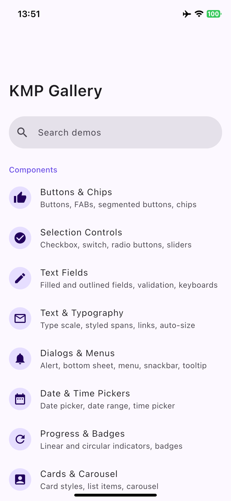
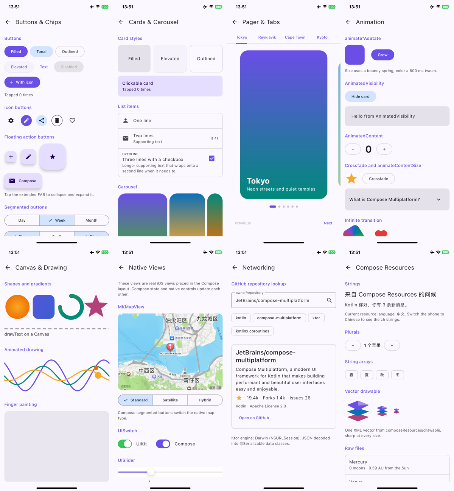

<div align="center">

# Kotlin Multiplatform Gallery

[English](README.md) · **简体中文**

一个 iOS 应用里集中展示 21 个 Compose Multiplatform 示例：Material 3 组件、懒加载列表与网格、Pager、App Bar、动画、Canvas、手势、Compose Resources、`expect` / `actual` 平台 API、嵌在 Compose 里的 MapKit 与 UIKit 视图、Ktor 网络请求、协程与 Flow、持久化存储。<br/>
整个界面都是共享的 Kotlin 代码，iOS 应用只是外面一层很薄的 SwiftUI。<br/>
在 Windows、Linux、macOS 上用 [KXBuild](https://github.com/kxbuild/kxbuild) 即可编译并安装到 iPhone 上运行。



</div>

## 包含内容

| 分类 | 示例 | 展示内容 |
|---|---|---|
| **组件** | Buttons & Chips | 填充 / 色调 / 描边 / 浮起 / 文本按钮，图标按钮，FAB，单选与多选分段按钮，Assist / Filter / Input / Suggestion Chip |
| | Selection Controls | 带子项的 `TriStateCheckbox`、带图标的 `Switch`、单选组、`Slider`（连续与分档）、`RangeSlider` |
| | Text Fields | 填充与描边输入框、邮箱校验、密码显示切换、电话与小数键盘、前后缀、字数统计 |
| | Text & Typography | Material 字号体系、字体样式、渐变文字、带链接的 `AnnotatedString`、`SelectionContainer`、省略号、`TextAutoSize` |
| | Dialogs & Menus | `AlertDialog`、`ModalBottomSheet`、`DropdownMenu`、带操作的 Snackbar、Tooltip |
| | Date & Time Pickers | `DatePickerDialog`、`DateRangePicker`、可切换键盘输入的 `TimePicker`、内联 `DatePicker` |
| | Progress & Badges | 线性与环形进度（不确定与动画进度）、`BadgedBox` |
| | Cards & Carousel | 填充 / 浮起 / 描边卡片、`ListItem` 各种样式、`HorizontalMultiBrowseCarousel` |
| **布局与导航** | Lazy Lists | 吸顶分组标题、左滑删除、`animateItem`、`PullToRefreshBox` |
| | Grids & Flow Layouts | 带通栏标题的 `LazyVerticalGrid`、`LazyVerticalStaggeredGrid`、`FlowRow` |
| | Pager & Tabs | 页面缩放的 `HorizontalPager`、与 Pager 联动的 Tab、页码指示器 |
| | App Bars & Navigation | 可折叠的 `MediumTopAppBar`、带角标的 `NavigationBar`、`ModalNavigationDrawer`、随滚动收起的扩展 FAB |
| **图形与动效** | Animation | 弹簧 `animate*AsState`、`AnimatedVisibility`、`AnimatedContent`、`Crossfade`、`animateContentSize`、无限动画、`Animatable` |
| | Canvas & Drawing | 形状、路径、线性 / 径向 / 扫描渐变、虚线、`drawText`、动画波形、手指绘画 |
| | Gestures | 单击 / 双击 / 长按、拖动、用 `transformable` 双指缩放 + 旋转 + 平移 |
| **Kotlin Multiplatform** | Compose Resources | 多语言字符串（英文、中文）、复数、字符串数组、XML 矢量图、用 `Res.readBytes` 读取 JSON 文件 |
| | Platform APIs | 由 `UIDevice`、`NSProcessInfo`、触感反馈、`UIActivityViewController`、`openURL` 实现的 `expect` / `actual` 函数 |
| | Native Views | 用 `UIKitView` 嵌入 `MKMapView`、`UISwitch`、`UISlider`、`UIDatePicker`，并与 Compose 状态双向同步 |
| | Networking | Darwin 引擎的 Ktor 客户端、kotlinx.serialization、查询 GitHub 仓库 |
| | Coroutines & Flow | 可取消的计时器、并行 `async` / `awaitAll`、`snapshotFlow` 防抖搜索、`Dispatchers.Default` 上的计算任务 |
| | Key-Value Storage | 通过 `expect object` 存进 `NSUserDefaults` 的设置项和 JSON 待办列表 |

首页支持搜索，导航使用 Navigation 3，应用跟随系统浅色 / 深色模式。



基于 Kotlin 2.4.21、Compose Multiplatform 1.12.1、Material 3、Navigation 3 和 Ktor 3.6，最低支持 iOS 16。

## 在 iPhone 上运行

准备：已安装 KXBuild（[安装说明](https://github.com/kxbuild/kxbuild/blob/main/README_zh.md)），配置好[签名](https://github.com/kxbuild/kxbuild/blob/main/README_zh.md)，并装有 JDK 17 或更高版本（装了 Android Studio 也可以，它自带 JDK）。

```shell
git clone https://github.com/kxbuild/kotlin-multiplatform-gallery.git
cd kotlin-multiplatform-gallery

# 每台电脑执行一次，升级 Kotlin 后再执行一次：为 iOS 准备好 Kotlin/Native
kxbuild doctor iosApp/KmpGallery.xcodeproj

# 编译，安装到 USB 连接的 iPhone 并启动
kxbuild run iosApp/KmpGallery.xcodeproj
```

第一次编译要下载 Gradle 和 Kotlin 依赖库并链接 Kotlin framework，需要几分钟。编译过程会自动执行 `./gradlew :composeApp:embedAndSignAppleFrameworkForXcode`，不需要手动运行 Gradle。

Bundle ID 是 `com.kxbuild.kmpgallery`。如果你的描述文件不包含它，换成你自己的：

```shell
kxbuild project add-setting --project iosApp/KmpGallery.xcodeproj --target KmpGallery --key PRODUCT_BUNDLE_IDENTIFIER --value com.yourcompany.kmpgallery
```

想启动后直接打开某个示例，把它的 id 作为启动参数传入，例如 `--args "-demo native"`。全部 id 见 [Demo.kt](composeApp/src/commonMain/kotlin/com/kxbuild/kmpgallery/Demo.kt)。

发布到 App Store 时用 Release 配置编译，`.ipa` 生成在 `iosApp/build` 下：

```shell
kxbuild build iosApp/KmpGallery.xcodeproj -c Release
```

### 在 VS Code 里开发

安装 KXBuild 扩展，打开本目录，在 KXBuild 视图里选中 iPhone 后按 F5，即可编译、安装并调试。

## 目录结构

```
composeApp/src/
  commonMain/kotlin/…/kmpgallery/
    App.kt                  主题、导航和首页
    Demo.kt                 示例列表及其 id
    Platform.kt             平台 API 的 expect 声明
    demos/Components.kt     按钮、选择控件、文本、对话框、选择器、进度、卡片
    demos/Layout.kt         列表、网格、Pager、App Bar
    demos/Graphics.kt       动画、Canvas、手势
    demos/Multiplatform.kt  资源、平台 API、网络、协程、存储
  commonMain/composeResources/   字符串（values、values-zh）、矢量图、文件
  iosMain/kotlin/…/kmpgallery/
    MainViewController.kt   ComposeUIViewController 入口
    Platform.ios.kt         用 UIKit 和 Foundation 写的 actual 实现
    PlatformViews.ios.kt    嵌入 Compose 的 MapKit 与 UIKit 视图
iosApp/
  KmpGallery.xcodeproj      Xcode 工程，其中一个构建阶段负责编译 Kotlin framework
  KmpGallery/               SwiftUI 入口和资源
```

新增示例：在某个 `demos` 文件里写一个 `@Composable` 函数，再在 `Demo` 枚举里加一项。

## 相关仓库

- [**KXBuild**](https://github.com/kxbuild/kxbuild)：在 Windows、Linux、macOS 上编译、运行、发布 iOS App 的命令行工具和 VS Code 插件
- [SwiftUI Gallery](https://github.com/kxbuild/swift-gallery)：15 个面向 iOS 17 的 SwiftUI 示例
- [UIKit Gallery（Objective-C）](https://github.com/kxbuild/objc-gallery)：14 个 Objective-C 编写的 UIKit 示例，所有视图都在代码里创建
- [Flutter Gallery](https://github.com/kxbuild/flutter-gallery)：Material 与 Cupertino 组件，外加四个完整示例应用
- [React Native Gallery](https://github.com/kxbuild/react-native-gallery)：16 个 React Native 内置组件与 API 示例
- [Expo Gallery](https://github.com/kxbuild/expo-gallery)：22 个 Expo SDK 模块：相机、传感器、定位、SQLite 等
- [Godot Gallery](https://github.com/kxbuild/godot-gallery)：10 个 Godot 4 示例，导出为 iOS 工程
- [Unity Gallery](https://github.com/kxbuild/unity-gallery)：10 个 Unity 6 示例，导出为 iOS 工程
- [KXBuild 应用模板](https://github.com/kxbuild/kxbuild-app-templates)：`kxbuild project create` 和 `add-target` 使用的项目与 target 模板，欢迎贡献

## 许可证

Apache 2.0，见 [LICENSE](LICENSE)。Kotlin 和 Compose Multiplatform 是 JetBrains s.r.o. 的商标。iOS、UIKit 和 MapKit 是 Apple Inc. 的商标。
